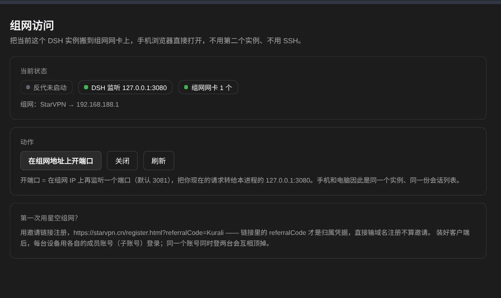

# dsh-mesh-access

**Control your DSH from your phone.** Open the address in a phone browser and you get the very
same UI you are using on the desktop — same instance, same session list, same context. No SSH,
no second `dsh`, no router to touch.

Under the hood it mounts the running DeepSeek Harness web UI onto a mesh/VPN interface, from
inside the server process.

[English](#what-it-does) | [中文](README.md)



## What it does

`dsh web --host` binds exactly one concrete interface address, and it rejects wildcards. So a
server that serves `127.0.0.1:3080` is invisible to your mesh, and a TAP (`StarVPN`) or `utun`
interface created *after* boot is not where it listens.

This plugin adds a mesh port **inside the running process**:

```
any device ──▶ 192.168.188.1:3081 ──▶ (plugin proxy) ──▶ 127.0.0.1:3080  (the same dsh you are using)
```

One instance. One session list. No `task-board ledger is already owned by …` warning, no
half-synced state between two servers.

## Install

```bash
dsh plugin --profile web add dsh-mesh-access
```

No npm / behind a China mirror? Use the release tarball:

```bash
dsh plugin --profile web add \
  https://github.com/SilverKurali/dsh-mesh-access/releases/latest/download/dsh-mesh-access.tgz
```

From a checkout: `dsh plugin --profile web add link:/absolute/path/to/dsh-mesh-access`.
Full matrix (npm / tarball / checkout / git URL), verification and troubleshooting: [INSTALL.en.md](INSTALL.en.md).

Restart the profile. A **组网访问 / Mesh access** entry appears in the left rail:

| Block | What it shows |
|---|---|
| 当前状态 | proxy state, DSH's own listen port, how many mesh interfaces were found |
| 动作 | open the mesh port / close it / refresh |
| 手机地址 | the URL to open on the phone, with a copy button |
| Public tunnel (optional) | use **your own** server as a public entry point: start/stop frpc, show the public URL, probe it for real |
| 第一次用星空组网？ | the referral sign-up link and the member-account rule |

## HTTP surface

The panel is a view over two routes kept deliberately small:

```
GET  /api/dsh-mesh-access/status     → { host:{upstream,port}, interfaces[], mesh[], proxy{...}, referral }
POST /api/dsh-mesh-access/proxy      → {action:'start'|'stop', port?}
```

`curl -s localhost:3090/api/dsh-mesh-access/status` is enough to debug without a browser.

## Configuration

Optional, written in the profile's patch layer; every key has a default:

```yaml
- id: mesh
  name: dsh-mesh-access
  config:
    interfacePattern: '^(StarVPN|utun\d+|tap\d+|tun\d+|wg\d+|gpd\d+|ppp\d+|ipsec\d+)$'
    addressPrefix: '192.168.'
    proxyPort: 3081
    upstream: 127.0.0.1
```

`addressPrefix` exists so a public address on a `tun*` interface is never mistaken for a mesh
address.

## Why the cookie survives

A request with `?token=` answers `303` and sets `dsh-auth-*` (`HttpOnly`, `SameSite=Strict`,
`Max-Age=2592000`). The cookie payload embeds the **authority it was issued for**, signed with a
secret kept in a persistent credential record — not a per-process random — so it outlives a
restart. The proxy rewrites `Host` to the upstream authority on every request, which keeps the
baked-in authority equal to what the server expects, which is why the same cookie keeps working
through the mesh port.

Corollary: change the mesh IP or the port and you must open a fresh token URL once.

## Limitations

- The plugin cannot move **its own process's** listen address. The mesh port is a reverse proxy, not a second bind.
- IPv4 mesh addresses only.
- One `~/.dsh` still admits only one task-board lock holder; that is deliberate, and this plugin exists to avoid needing a second instance.

## Performance and limits (measured)

Whether this feels good depends on **how the mesh picks a path**, not on the plugin. Numbers below were measured
on 2026-11-07 on a real link, so you can tell "is it the plugin?" — almost always it is not.

| Path | One-way latency | Note |
|---|---|---|
| Same LAN (`10.x.y.z:3081`) | **1–3 ms** | direct, feels local |
| Mesh direct (`path=P2P`) | 30–80 ms | best case, needs both sides hole-punchable |
| Mesh UDP relay | 60–150 ms | workable |
| Mesh **TCP relay** (`path=SN-TCP`) | **840–990 ms**, worst seen 3.7 s | painful, see below |

The TCP relay is TCP inside TCP: one lost packet stalls the whole ordered stream, so latency is amplified ~10×.
Worse, a phone on carrier-grade NAT keeps changing its address; the client then isolates the P2P link and falls back:

```
[P2P] isolated the old direct link, waiting for a new P2P confirmation; policy picks Mesh/Supernode
[SN-RTT] Supernode round trip is slow: ... rtt=891ms path=SN-TCP
```

On such a link the DSH realtime channel's heartbeat times out periodically, which the UI shows as
an endless **"reconnecting…"** banner. The plugin already removes two of the amplifiers:

1. **rewrites `Origin`** — otherwise the WebSocket upgrade is rejected by DSH's own origin check with 403 and never connects;
2. **adds `immutable` caching for `/assets/*`** — upstream sends no cache headers at all, so every reload used to re-transfer ~2.4 MB.

Heartbeat timeouts themselves are not fixable in the plugin. Check the server side first:

```bash
grep -E 'SN-RTT|path=SN-TCP|peer-info-address-changed' /usr/local/lib/stars/res/stars.log | tail
```

- `path=SN-TCP` with `rtt` stuck above 800 ms → change the link, not the plugin;
- for dependable remote access, put a VPS (ideally in the same country) in front and let the PC dial out to it,
  instead of relying on a mesh where both peers sit behind NAT and can only relay.

## Not just phones

The name says phone, the mechanism says otherwise: the plugin forwards requests that arrive on a
mesh address to the port this process already serves. Anything that can open a web page on the
mesh works — a phone or tablet, another Windows/macOS/Linux laptop, a NAS with a GUI
(Synology DSM, QNAP QTS, TrueNAS Scale), even a TV stick's browser.

Requirements are only: same mesh, a route to the mesh IP, and a browser. **Nothing** has to be
installed on the other device, and no SSH is involved.

## Use your own server (optional)

The mesh path is fine on a LAN or a P2P link, but it can fall back to a public relay: measured RTT 800-990 ms (worst
3.7 s), and long-lived connections get dropped by heartbeat timeouts — on a phone that looks like a page stuck on
"reconnecting". If you have your own server with a public IP, point the tunnel at it: usually 30-60 ms.

**We do not provide a server, and you do not use somebody else's.** It is your box, your credentials. Two scripts ship
in this repo:

```bash
# 1) on your server (root): install frps
sudo ./tools/frps-setup.sh --port 7000 --http-port 21081
#    with HTTPS: add --domain dsh.example.com --email you@example.com

# 2) on the machine running DSH: install frpc and point it at that server
./tools/frpc-setup.sh --server <server-ip> --token <token printed in step 1> --remote-port 21081
```

Then open "组网访问" → "公网隧道" → start. Step 1 prints the token and the exact step-2 command for you.
The cloud security group must allow **7000/tcp** and **21081/tcp** — only you can do that.

Full guide (prerequisites, domain/TLS/Basic auth, troubleshooting, uninstall): **[docs/VPS.md](docs/VPS.md)**.
To let an AI do the setup, hand it **[docs/AI-SETUP.md](docs/AI-SETUP.md)**.

## Companion

The shell-script edition (Linux/macOS/Windows launchers that start a *second* dsh instance bound
to the mesh IP, with firewall rules and QR codes) is
[dsh-mesh-kit](https://github.com/SilverKurali/dsh-mesh-kit). Use this plugin when you want one
instance; use that kit when DSH is not running yet, or on a machine without a Node plugin install.

MIT.
