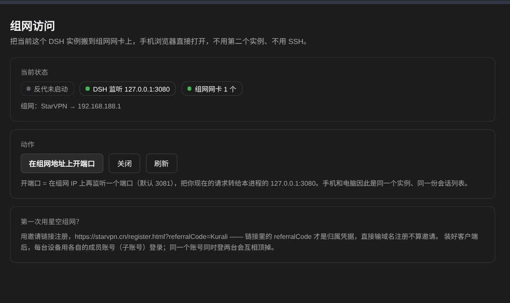

# dsh-mesh-access

**用手机远程控制电脑上的 DSH。** 手机浏览器打开，就是你在电脑上正在用的那个界面 ——
同一个实例、同一份会话、同一份上下文，不需要 SSH，不需要第二个 `dsh`，也不用碰路由器。

底层做法是把正在运行的 DeepSeek Harness 网页界面挂到组网网卡上，在服务进程内部完成。

[中文](#它做什么) | [English](README.en.md)



## 它做什么

`dsh web --host` 只接受**一个具体的网卡地址**，并且拒绝通配。所以只监听 `127.0.0.1:3080` 的实例，
组网里的手机、笔记本、另一台电脑、带图形界面的 NAS 都看不见；而开机之后才出现的 TAP（星空组网的 `StarVPN`）或 `utun` 网卡，也不在它启动时的那一份地址表里。

这个插件在**已经在跑的那个进程内部**多开一个组网端口：

```
任何设备 ──▶ 192.168.188.1:3081 ──▶（插件反代）──▶ 127.0.0.1:3080（你正在用的这个 dsh）
```

一个实例、一份会话列表：不会出现 `task-board ledger is already owned by …`，也不会出现两台服务状态不同步。

## 安装

```bash
dsh plugin --profile web add dsh-mesh-access
```

不方便用 npm，或者你的 npm 指向国内镜像？用 Release 里的 tgz：

```bash
dsh plugin --profile web add \
  https://github.com/SilverKurali/dsh-mesh-access/releases/latest/download/dsh-mesh-access.tgz
```

从本地目录装（改代码的人用这个）：

```bash
dsh plugin --profile web add link:/绝对路径/dsh-mesh-access
```

完整的四种装法、验证步骤、卸载与故障表见 [INSTALL.md](INSTALL.md)。

装完重启 profile，左侧导航会多出**「组网访问」**：

| 功能块 | 内容 |
|---|---|
| 当前状态 | 反代是否在跑、DSH 自己的监听端口、找到几张组网网卡 |
| 动作 | 在组网地址上开端口 / 关闭 / 刷新 |
| 访问地址 | 给组网内任何设备打开的地址（带 token，可直接复制） |
| 第一次用星空组网？ | 邀请注册链接 + 成员账号规则 |

## HTTP 接口

面板只是两个接口的外壳，故意做得极小：

```
GET  /api/dsh-mesh-access/status   → { ok, host:{upstream,port}, interfaces[], mesh[], proxy{...}, referral }
POST /api/dsh-mesh-access/proxy    → { action:'start' | 'stop', port? }
```

不开浏览器也能排查：

```bash
curl -s http://127.0.0.1:3080/api/dsh-mesh-access/status
```

## 配置（可选）

写在 profile 的 patch 层里，每一项都有默认值：

```yaml
- id: mesh
  name: dsh-mesh-access
  config:
    interfacePattern: '^(StarVPN|utun\d+|tap\d+|tun\d+|wg\d+|gpd\d+|ppp\d+|ipsec\d+)$'
    addressPrefix: '192.168.'
    proxyPort: 3081
    upstream: 127.0.0.1
```

`addressPrefix` 的作用是别把 `tun*` 上的公网地址当成组网地址。

## 为什么 cookie 能一直用

带 `?token=` 的请求返回 `303` 并种下 `dsh-auth-*`（`HttpOnly`、`SameSite=Strict`、`Max-Age=2592000`，
即 30 天）。cookie 载荷里写死了**签发时的 authority**：

```json
{"version":1,"authority":"192.168.188.1:3081","issuedAt":…,"expiresAt":…}
```

签名密钥存在**持久的凭据记录**里（不是每进程随机），所以重启也在。反代每次请求都把 `Host`
改写成上游 authority，于是 cookie 里的 authority 与服务端期望的一致 —— 这就是换个端口访问还能继续用
同一份 cookie 的原因。

反过来也成立：**换了组网 IP 或端口，就得重新点一次 token 链接。**

## 限制

- 插件动不了**自己进程**的监听地址。组网端口是反代，不是把主服务再绑一次。
- 只考虑 IPv4 组网地址。
- 仍然依赖隧道本身的质量。星空组网走中继时实测单向约 0.4 MB/s，`[SN-RTT]` 会抖到几秒，
  长回答可能中途停住，刷新一下能接回来。
- 同一份 `~/.dsh` 只允许一个实例持有 task-board 锁；这是刻意的，本插件就是为避开它而存在。

## 不只手机

名字叫 phone，但插件本身跟“手机”没有关系 —— 它做的是**把组网地址上的请求转给本进程**。
组网里任何能打开网页的设备都能用：

| 设备 | 用法 |
|---|---|
| 手机 / 平板 | 浏览器打开那条带 token 的地址，可加到桌面当 App |
| 另一台电脑（Win / macOS / Linux） | 同一个地址，直接开；不用装 DSH，也不用装这个插件 |
| 带图形界面的 NAS（群晖 DSM、威联通 QTS、TrueNAS Scale 等） | NAS 上的浏览器打开即可 |
| 电视盒子 / 平板上的浏览器 | 同理，只要能连到 `192.168.188.1` |

条件是三条：它在**同一个星空组网**里、能路由到组网 IP、浏览器能发 HTTP。
**不需要**在对方设备上装任何东西，也不需要 SSH。

## 配套

命令行版（在 DSH 还没启动、或者机器上没有 Node 插件环境时使用：
起**第二个**实例绑到组网 IP，附带防火墙规则与二维码）：
[dsh-mesh-kit](https://github.com/SilverKurali/dsh-mesh-kit)，支持 Linux / macOS / Windows。

设计取舍与实测数据见 [docs/architecture.md](docs/architecture.md)。

## 许可

MIT。

## 常见问题

**页面能打开、侧边栏也有，但底部一直「重新连接中…」，工作区列表空着**

这是 1.0.0 的 bug，升级到 **1.0.1** 即可。原因：反代把 `Host` 改写成上游（`127.0.0.1:3080`）却没改 `Origin`，DSH 对 WebSocket 升级做同源校验，浏览器带着 `Origin: http://<组网IP>:<端口>` 过来，两边不一致 → 上游直接 `403 Forbidden`。于是普通 HTTP 全通（页面能开、API 能查），实时通道一次都没握上手，浏览器每几秒重试一次，看起来就像“网络一直断”。

自查一行就够：

```bash
curl -s -o /dev/null -w '%{http_code}\n' --http1.1 \
  -H 'Connection: Upgrade' -H 'Upgrade: websocket' \
  -H 'Sec-WebSocket-Version: 13' -H 'Sec-WebSocket-Key: dGhlIHNhbXBsZSBub25jZQ==' \
  -H "Origin: http://<组网IP>:<端口>" \
  -b <你浏览器的 cookie> \
  http://<组网IP>:<端口>/api/remote.mux
```

`101` 是正常，`403` 就是中了这个 bug。

**改了端口或组网 IP，面板上的地址还能用吗**

不能。反代一开出来，监听地址和上游端口就固定了；「访问地址」里的 token 也是按当时的地址签的。换了就点「关闭」→「在组网地址上开端口」，重新复制地址。

**组网里的设备打开地址却超时**

先确认那台设备能路由到组网 IP（`ping <组网IP>`），再确认本机防火墙放行该端口。Linux 上 `firewall-cmd --zone=<组网域> --list-ports`，Windows 上查该端口的入站规则。
